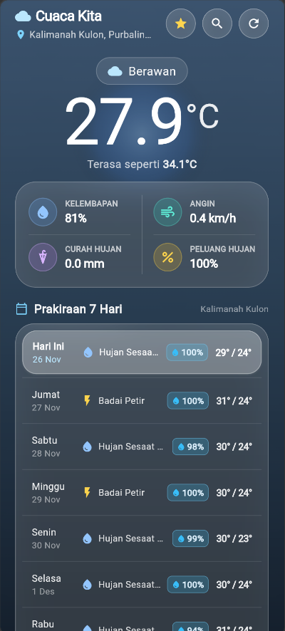
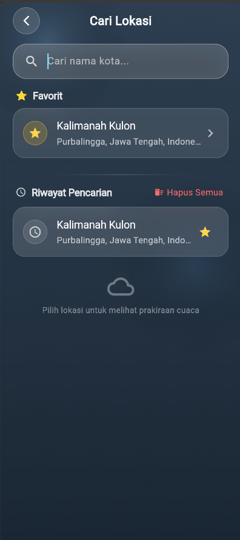
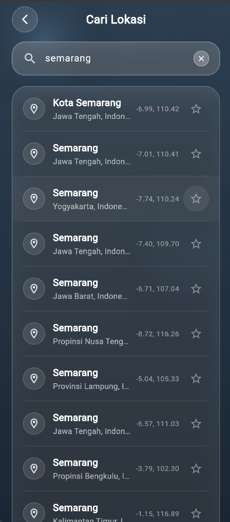

# Dokumentasi Proyek Responsi Pemrograman Mobile
## Aplikasi Cuaca Kita

Proyek ini dikembangkan untuk memenuhi tugas Responsi Pemrograman Mobile, Program Studi S1 Informatika, Fakultas Teknik, Universitas Jenderal Soedirman.

---

## Informasi Tugas dan Pengumpulan

- Mata Kuliah: Pemrograman Mobile
- Program Studi: S1 Informatika, Universitas Jenderal Soedirman
- Tautan Video Penjelasan: https://youtu.be/2x8j4a--fZw

---

## Tangkapan Layar Aplikasi

Berikut adalah dokumentasi visual dari antarmuka aplikasi yang telah diimplementasikan:

| Home / Weather Screen | Search Screen (Favorit dan Riwayat) | Search Screen (Hasil Pencarian) |
| :---: | :---: | :---: |
|  |  |  |
| Tampilan cuaca lokasi Kalimanah Kulon, 9 parameter wajib, dan prakiraan 7 hari | Daftar lokasi favorit dan riwayat pencarian tersimpan di SharedPreferences | Pencarian kota secara langsung menggunakan Geocoding API dengan debounce |

---

## Ringkasan

Aplikasi Cuaca Kita merupakan aplikasi prakiraan cuaca berbasis mobile yang dikembangkan menggunakan framework Flutter versi 3.47 dan bahasa pemrograman Dart versi 3.13 dengan fitur null-safety. Seluruh data cuaca dan koordinat geografis diambil secara langsung dari REST API Open-Meteo tanpa menggunakan data statis maupun data tiruan.

Arsitektur perangkat lunak yang diterapkan adalah Model-View-ViewModel (MVVM) yang dipadukan dengan pustaka Provider sebagai pengelola state reaktif. Penyimpanan data lokal diimplementasikan menggunakan pustaka SharedPreferences untuk menjamin persistensi data lokasi favorit, riwayat pencarian, dan lokasi terakhir yang dipilih pengguna.

---

## Fitur Aplikasi

1. Pemantauan Cuaca Terkini: Menampilkan data cuaca terkini lokasi tempat tinggal pengguna, secara real-time.
2. Sembilan Parameter Cuaca Wajib: Menampilkan suhu terkini, suhu yang dirasakan (apparent temperature), kelembapan udara, curah hujan, kecepatan angin, kode kondisi cuaca WMO beserta deskripsi Bahasa Indonesia dan ikon, peluang hujan hari ini, serta suhu maksimum dan minimum harian.
3. Prakiraan Cuaca Tujuh Hari: Menampilkan data prakiraan cuaca selama 7 hari ke depan dengan penanda khusus pada hari ini.
4. Pencarian Kota dengan Debounce: Menyediakan fitur pencarian lokasi global dengan jeda waktu debounce 500 milidetik guna mengoptimalkan efisiensi request jaringan.
5. Manajemen Lokasi Favorit: Memungkinkan pengguna menyimpan dan menghapus kota favorit. Fitur ini dilengkapi gesture swipe-to-dismiss untuk menghapus data.
6. Riwayat Pencarian: Mencatat maksimal 10 lokasi terakhir yang pernah dipilih pengguna serta menyediakan opsi untuk menghapus seluruh riwayat sekaligus.
7. Persistensi Data: Seluruh data favorit, riwayat pencarian, dan lokasi terakhir tetap tersimpan di dalam media penyimpanan lokal perangkat dan akan dimuat kembali saat aplikasi dibuka ulang.
8. Sinkronisasi Data: Mendukung mekanisme pull-to-refresh dan tombol pembaruan cuaca manual.
9. Penanganan Status Aplikasi: Menyediakan visualisasi antarmuka saat proses pemuatan data (loading), data tidak ditemukan (empty), dan kegagalan jaringan (error) yang dilengkapi tombol coba lagi.

---

## Spesifikasi Ketergantungan (Dependencies)

Ketergantungan yang digunakan dalam berkas `pubspec.yaml` adalah sebagai berikut:

```yaml
dependencies:
  flutter:
    sdk: flutter
  cupertino_icons: ^1.0.8
  http: ^1.3.0               # Klien HTTP untuk konsumsi REST API Open-Meteo
  provider: ^6.1.0           # Manajemen state berbasis ChangeNotifier
  shared_preferences: ^2.3.0 # Penyimpanan data lokal permanen (Key-Value)
  intl: ^0.19.0              # Format tanggal dan hari lokal Bahasa Indonesia (id_ID)

dev_dependencies:
  flutter_test:
    sdk: flutter
  flutter_lints: ^6.0.0      # Aturan analisis statis resmi Flutter
```

Izin akses internet telah ditambahkan pada berkas konfigurasi `android/app/src/main/AndroidManifest.xml`:

```xml
<uses-permission android:name="android.permission.INTERNET"/>
```

---

## 1. Struktur Aplikasi dan Penjelasan Direktori

Proyek ini disusun dengan pemisahan tanggung jawab yang terstruktur rapi pada direktori `lib/`:

```
lib/
├── main.dart                       # Titik masuk aplikasi, inisialisasi MultiProvider dan tema
├── core/
│   ├── constants/
│   │   └── api_constants.dart      # URL dasar, path endpoint, parameter, dan batas timeout
│   ├── enums/
│   │   └── view_state.dart         # Status antarmuka: initial, loading, success, empty, error
│   ├── theme/
│   │   └── app_theme.dart          # Konfigurasi ThemeData Material 3 bertema gelap
│   └── utils/
│       └── weather_code_mapper.dart # Pemetaan kode cuaca WMO ke teks Bahasa Indonesia dan ikon
├── models/
│   ├── location_model.dart         # Model lokasi hasil Geocoding API dan serialisasi lokal
│   ├── current_weather_model.dart  # Model representasi data cuaca saat ini
│   ├── daily_forecast_model.dart   # Model penggabungan data harian paralel
│   └── weather_model.dart          # Model gabungan data cuaca saat ini dan harian
├── services/
│   ├── weather_api_service.dart    # Layanan HTTP GET ke endpoint prakiraan cuaca
│   ├── geocoding_api_service.dart  # Layanan HTTP GET ke endpoint pencarian geocoding
│   └── local_storage_service.dart  # Layanan I/O SharedPreferences (favorit, riwayat, lokasi)
├── repositories/
│   └── weather_repository.dart     # Lapisan abstraksi data (penghubung Service dan ViewModel)
├── viewmodels/
│   ├── weather_viewmodel.dart      # Pengelola state data cuaca Home Screen
│   └── search_viewmodel.dart       # Pengelola state pencarian, data favorit, dan riwayat
└── views/
    ├── home_screen.dart            # Halaman utama cuaca
    ├── search_screen.dart          # Halaman pencarian lokasi, daftar favorit, dan riwayat
    └── widgets/
        ├── current_weather_card.dart # Widget kartu kondisi cuaca terkini dan metriks 2x2
        ├── forecast_tile.dart        # Widget baris data prakiraan cuaca harian
        ├── loading_view.dart         # Widget indikator pemuatan data
        ├── empty_view.dart           # Widget representasi data kosong
        └── error_view.dart           # Widget pesan kesalahan dengan tombol coba lagi
```

---

## 2. Implementasi REST API Open-Meteo

Aplikasi menggunakan dua endpoint publik resmi dari penyedia Open-Meteo yang dapat diakses tanpa memerlukan API key.

### A. Geocoding API (Pencarian Lokasi)

- Protokol dan Domain: `https://geocoding-api.open-meteo.com`
- Jalur Endpoint: `/v1/search`
- Metode Permintaan: `HTTP GET`
- Parameter Query:
  - `name`: String kata kunci nama kota (contoh: "Purbalingga", "Jakarta")
  - `count`: `10` (membatasi hasil maksimal 10 entri)
  - `language`: `id` (mengutamakan penamaan dalam Bahasa Indonesia)
  - `format`: `json`
- Penanganan Respons: Respons diolah melalui method `LocationModel.fromJson()`. Apabila kota tidak terdaftar pada basis data geocoding, field `results` akan bernilai `null` dan sistem mengembalikan list kosong yang memicu state `ViewState.empty`.

### B. Weather Forecast API (Prakiraan Cuaca)

- Protokol dan Domain: `https://api.open-meteo.com`
- Jalur Endpoint: `/v1/forecast`
- Metode Permintaan: `HTTP GET`
- Parameter Query:
  - `latitude`: Koordinat lintang lokasi (contoh: `-7.4050` untuk Kalimanah Kulon)
  - `longitude`: Koordinat bujur lokasi (contoh: `109.3360` untuk Kalimanah Kulon)
  - `current`: `temperature_2m,relative_humidity_2m,apparent_temperature,precipitation,weather_code,wind_speed_10m`
  - `daily`: `weather_code,temperature_2m_max,temperature_2m_min,precipitation_probability_max`
  - `timezone`: `auto`
  - `forecast_days`: `7`
- Alasan Penggunaan `timezone=auto`: Parameter ini menginstruksikan server Open-Meteo untuk secara otomatis menyesuaikan pembacaan waktu harian berdasarkan zona waktu lokal koordinat target (Waktu Indonesia Barat / GMT+7), sehingga perhitungan tanggal dan hari selalu sinkron dengan waktu setempat.

### C. Pemetaan Sembilan Parameter Cuaca Wajib

Seluruh parameter wajib yang tercantum pada petunjuk penilaian responsi telah diimplementasikan secara menyeluruh:

| No | Parameter Penilaian | Field API Open-Meteo | Implementasi Tampilan di Aplikasi |
| :---: | :--- | :--- | :--- |
| 1 | Suhu saat ini | `current.temperature_2m` | Ditampilkan pada angka suhu utama berukuran besar |
| 2 | Kelembapan udara | `current.relative_humidity_2m` | Ditampilkan pada kotak metriks 2x2 (satuan %) |
| 3 | Suhu yang dirasakan | `current.apparent_temperature` | Ditampilkan pada teks keterangan "Terasa seperti..." |
| 4 | Curah hujan | `current.precipitation` | Ditampilkan pada kotak metriks 2x2 (satuan mm) |
| 5 | Kode kondisi cuaca | `current.weather_code` | Dipetakan via `WeatherCodeMapper` menjadi ikon dan teks Bahasa Indonesia |
| 6 | Kecepatan angin | `current.wind_speed_10m` | Ditampilkan pada kotak metriks 2x2 (satuan km/h) |
| 7 | Suhu maksimum harian | `daily.temperature_2m_max` | Ditampilkan pada kolom kanan baris prakiraan harian |
| 8 | Suhu minimum harian | `daily.temperature_2m_min` | Ditampilkan pada kolom kanan baris prakiraan harian |
| 9 | Peluang hujan maksimum | `daily.precipitation_probability_max` | Ditampilkan pada kartu metriks hari ini dan badge baris prakiraan 7 hari |

---

## 3. Penerapan Arsitektur Model-View-ViewModel (MVVM)

Arsitektur MVVM pada proyek ini memisahkan lapisan presentasi, logika bisnis, dan pengambilan data secara tegas:

```
[ VIEW ]                  [ VIEWMODEL ]              [ REPOSITORY ]            [ SERVICES ]             [ DATA SOURCE ]
HomeScreen / SearchScreen ──> WeatherVM / SearchVM ───> WeatherRepository ───────> WeatherApiService  ───> Open-Meteo REST API
(Murni Render Tampilan)   (ChangeNotifier & State)   (Single Source of Truth)   LocalStorageService ───> SharedPreferences
```

### 1. Lapisan Model (`lib/models/`)
Model bertanggung jawab mendefinisikan struktur data entitas serta logika konversi JSON (`fromJson` dan `toJson`). Model bersifat pasif dan tidak memiliki referensi ke antarmuka pengguna.
- Kelas `LocationModel` meng-override operator kesetaraan (`operator ==`) berbasis toleransi koordinat numerik guna memastikan perbandingan lokasi presisi dan tidak menghasilkan data duplikat pada SharedPreferences.
- Kelas `DailyForecastModel` mengubah struktur array paralel bawaan API (seperti array `time`, `weather_code`, dan temperatur) menjadi daftar objek terstruktur per hari melalui method `fromDailyJson()`.

### 2. Lapisan View (`lib/views/`)
View hanya bertugas menampilkan data yang disediakan oleh ViewModel dan meneruskan aksi pengguna (seperti penekanan tombol dan input teks).
- Tidak ada operasi pemanggilan HTTP GET langsung di dalam View.
- View mengonsumsi data secara reaktif menggunakan widget `Consumer` dari pustaka Provider, sehingga proses pembaruan antarmuka hanya terjadi pada widget yang berkepentingan tanpa memicu pembangunan ulang seluruh layar.

### 3. Lapisan ViewModel (`lib/viewmodels/`)
ViewModel bertindak sebagai jembatan logika antara View dan Repository. Kelas ViewModel mewarisi `ChangeNotifier`.
- Status data dikelola melalui variabel enum `ViewState` (`initial`, `loading`, `success`, `empty`, `error`).
- Ketika data selesai diproses dari Repository, ViewModel memanggil method `notifyListeners()` untuk memperbarui tampilan View.
- Pada `SearchViewModel`, diterapkan mekanisme debounce 500 milidetik menggunakan objek `Timer`. Setiap ketukan tombol baru akan membatalkan timer sebelumnya dan hanya menjalankan pencarian ke Repository apabila pengguna berhenti mengetik selama minimal 500 milidetik.

### 4. Lapisan Repository (`lib/repositories/`)
`WeatherRepository` berperan sebagai lapisan abstraksi data tunggal (Single Source of Truth). ViewModel tidak perlu mengetahui mekanisme teknis apakah data diperoleh dari jaringan internet atau dari media penyimpanan lokal.

### 5. Lapisan Service (`lib/services/`)
- `WeatherApiService` dan `GeocodingApiService` mengelola koneksi jaringan luar menggunakan pustaka `http` dengan batas waktu timeout 10 detik. Kesalahan jaringan ditangkap melalui blok try-catch terstruktur yang membedakan penanganan ketiadaan koneksi (`SocketException`), batas waktu terlampaui (`TimeoutException`), dan kegagalan format data (`FormatException`).
- `LocalStorageService` mengelola pembacaan dan penulisan berkas preferensi lokal menggunakan pustaka `shared_preferences`.

---

## 4. Implementasi Penyimpanan Lokal (Local Storage)

Aplikasi memanfaatkan pustaka `shared_preferences` untuk menyimpan preferensi pengguna secara permanen pada memori perangkat:

1. Lokasi Favorit (`favorites`):
   - Disimpan dalam bentuk daftar string JSON hasil serialisasi `LocationModel.toJsonString()`.
   - Menggunakan validasi koordinat sebelum penambahan data untuk mencegah duplikasi.
   - Dilengkapi interaksi penghapusan berbasis geser layar (swipe-to-dismiss) dan notifikasi visual singkat (SnackBar).
2. Riwayat Pencarian (`search_history`):
   - Secara otomatis mencatat lokasi yang dipilih oleh pengguna melalui halaman pencarian.
   - Dibatasi maksimal 10 entri terbaru dengan urutan kronologis terbalik (data terbaru berada di indeks teratas).
   - Menyediakan fitur tombol untuk menghapus seluruh riwayat secara instan.
3. Lokasi Terakhir yang Dipilih (`last_location`):
   - Menyimpan objek lokasi aktif setiap kali pengguna berganti kota.
   - Saat aplikasi ditutup dan dibuka kembali, method `loadLastLocationAndWeather()` akan memuat lokasi tersebut kembali secara otomatis.
4. Nilai Awal Default (Initial Seed):
   - Pada saat pemasangan awal aplikasi di mana belum ada data tersimpan, berkas preferensi lokal secara otomatis menginisialisasi lokasi Kalimanah Kulon pada daftar favorit dan riwayat untuk keperluan evaluasi demonstrasi.

---

## 5. Penanganan Status Antarmuka (State Handling)

Aplikasi memiliki penanganan kondisi antarmuka yang komprehensif berdasarkan nilai `ViewState`:

1. Kondisi Loading (`ViewState.loading`): Menampilkan widget `LoadingView` berupa indikator progres melingkar beserta penampung animasi shimmer.
2. Kondisi Sukses (`ViewState.success`): Menampilkan antarmuka cuaca lengkap beserta prakiraan harian.
3. Kondisi Kosong (`ViewState.empty`): Menampilkan widget `EmptyView` dengan ikon dan deskripsi informatif saat kota yang dicari tidak ditemukan pada server geocoding.
4. Kondisi Kesalahan (`ViewState.error`): Menampilkan widget `ErrorView` berlatar kemerahan yang menyajikan deskripsi permasalahan jaringan secara ramah pengguna (contoh: ketiadaan koneksi internet atau timeout) serta menyediakan tombol "Coba Lagi" untuk melakukan sinkronisasi ulang.

---

## 6. Hasil Pengujian dan Analisis Kualitas Kode

### Analisis Statis Kode (`flutter analyze`)
Pengujian analisis statis kode dijalankan menggunakan perkakas resmi Flutter Analyzer. Hasil eksekusi menunjukkan:

```powershell
PS D:\FlutterProjects\pemmob\weather99> flutter analyze
Analyzing weather99...
No issues found! (ran in 3.4s)
```

Hasil tersebut mengonfirmasi bahwa basis kode:
- Bebas dari kesalahan sintaksis maupun kesalahan kompilasi.
- Bebas dari peringatan (warnings) dan anjuran linter.
- Bebas dari penggunaan anggota atau properti yang telah usang (deprecated members).
- Mematuhi kaidah null-safety secara penuh.

### Pengujian Unit (`flutter test`)
Pengujian logika bisnis dan model diimplementasikan pada berkas `test/widget_test.dart`. Hasil eksekusi pengujian unit menunjukkan:

```powershell
PS D:\FlutterProjects\pemmob\weather99> flutter test
00:20 +18: All tests passed!
```

Seluruh 18 kasus uji dinyatakan lulus, mencakup:
- Pengujian pembentukan objek `LocationModel` dari JSON dan penanganan nilai null pada field opsional.
- Pengujian siklus bolak-balik serialisasi string JSON pada `LocationModel`.
- Pengujian kesetaraan objek berbasis koordinat geografis.
- Pengujian pembentukan objek `CurrentWeatherModel` dari respons API cuaca.
- Pengujian penggabungan array paralel menjadi list objek pada `DailyForecastModel`.
- Pengujian agregasi data pada `WeatherModel`.
- Pengujian pemetaan kode cuaca WMO beserta penanganan kode cuaca tidak dikenal pada `WeatherCodeMapper`.

---

## 7. Panduan Menjalankan Proyek

Berikut adalah langkah-langkah untuk menjalankan proyek ini pada lingkungan pengembangan lokal:

1. Buka terminal pada sistem operasi Anda dan arahkan ke direktori proyek:
   ```powershell
   cd d:\FlutterProjects\pemmob\weather99
   ```

2. Jalankan perintah untuk mengunduh seluruh dependensi yang diperlukan:
   ```powershell
   flutter pub get
   ```

3. Jalankan pengujian analisis statis untuk memastikan integritas kode:
   ```powershell
   flutter analyze
   ```

4. Jalankan pengujian unit otomatis:
   ```powershell
   flutter test
   ```

5. Jalankan aplikasi pada perangkat emulator Android atau perangkat fisik yang terhubung:
   ```powershell
   flutter run
   ```

---
